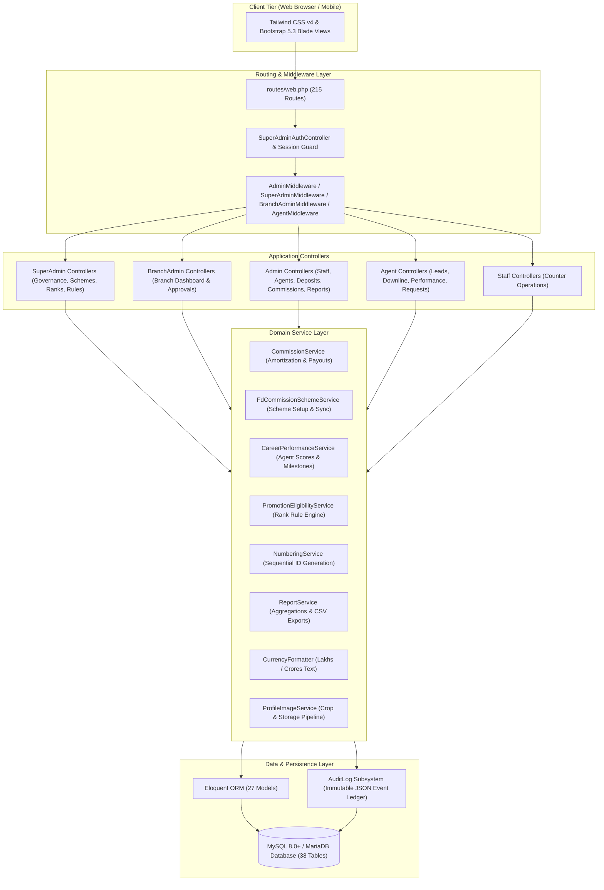
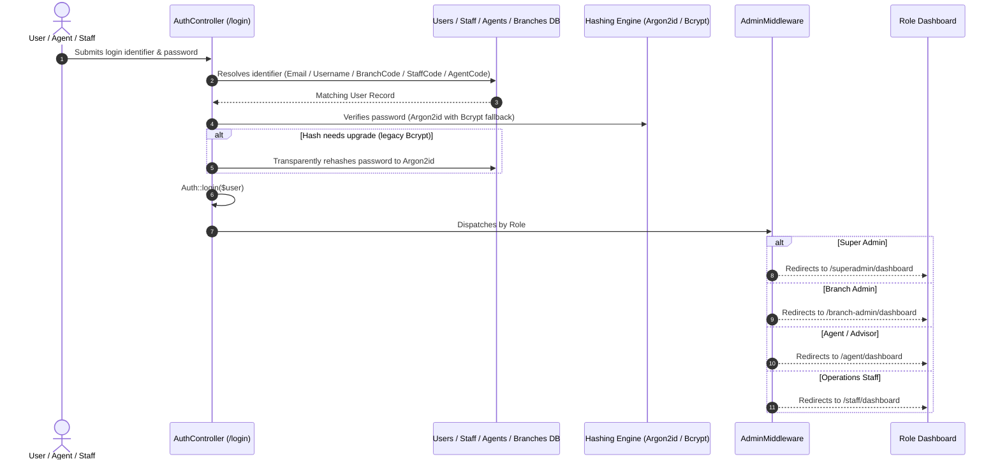
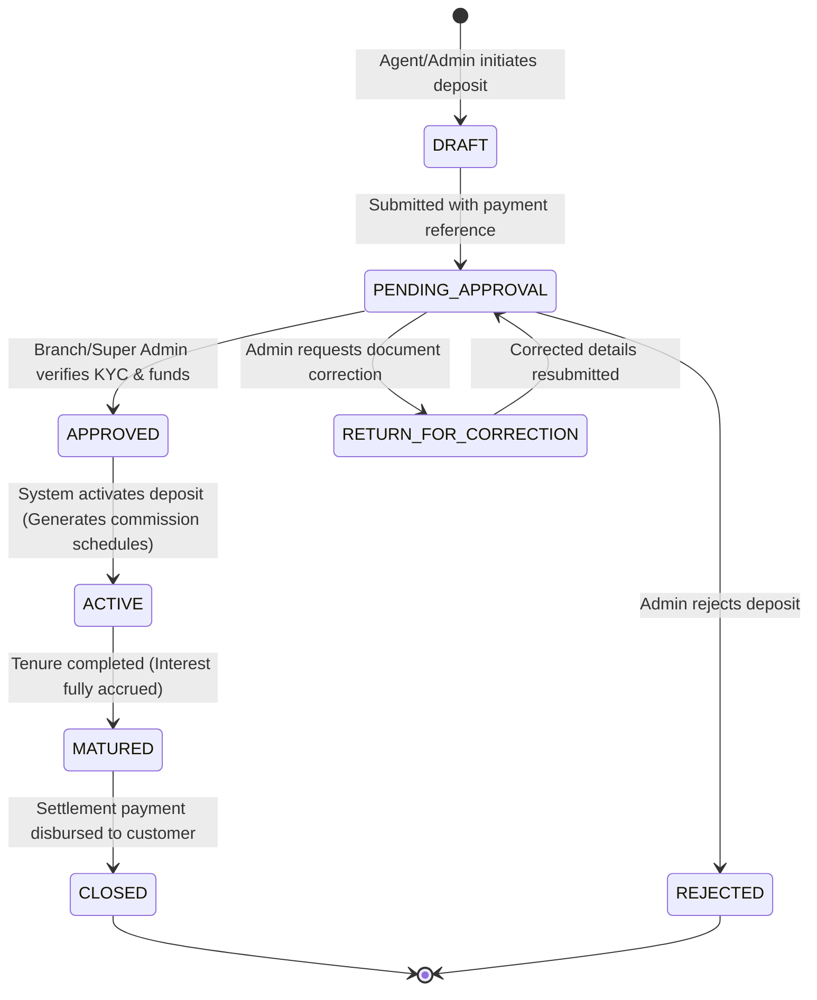
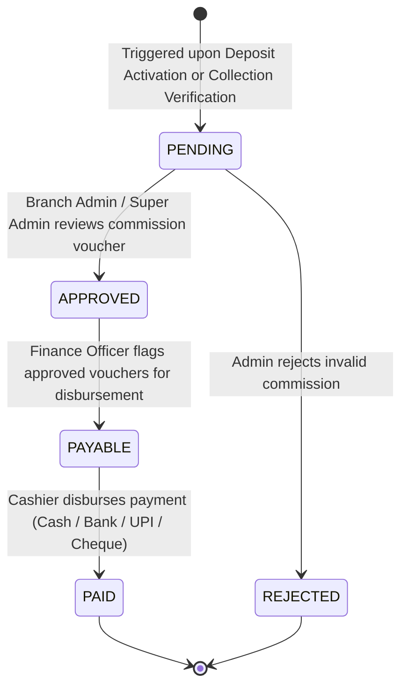

# Architecture: MultiCred Core Banking & Commission System

## 1. Architectural Philosophy & Overview

**MultiCred** is architected as a modular, monolithic Laravel application leveraging a **Controller-Service-Repository** pattern with explicit Form Requests, transactional boundaries (`DB::transaction`), and strict role-based middleware isolation.

The architecture prioritizes:
1. **Financial Integrity**: Decimal-safe computations (`bcadd`, explicit rounding), pessimistic database locking (`lockForUpdate`), and immutable audit logging.
2. **Strict Multi-Role Segregation**: Context-aware routing and middleware preventing cross-branch or cross-role privilege escalation.
3. **Decoupled Business Logic**: Financial formulas (interest schedules, commission amortizations, promotion scoring) are completely extracted into dedicated domain services.
4. **Dual-Layer Frontend Architecture**: Modern Tailwind CSS v4 design tokens combined with Bootstrap 5.3 components for reliable, responsive interfaces.

---

## 2. High-Level System Architecture Diagram

---

## 3. Architectural Layers

### 3.1 Presentation Layer (Blade + Vite + Dual CSS)
- **Blade Templating**: Reusable components (`resources/views/components/`), layout wrappers for each portal (`superadmin`, `branch-admin`, `agent`, `staff`), and modular partials.
- **Dual CSS System**:
  - **Tailwind CSS v4** (`resources/css/app.css`): Manages custom design tokens, spacing, typography (Inter & Instrument Sans), and agricultural brand palette (Deep Forest `#14532D`, Emerald `#064E3B`, Lime `#65A30D`, Gold `#D4A64A`).
  - **Bootstrap 5.3**: Used for responsive grid, table layouts, accessible dropdowns, modals, and badge components.
- **Vite 8.0**: Modern asset compilation pipeline using `@tailwindcss/vite` and `laravel-vite-plugin`.

### 3.2 Routing & Middleware Layer
- **Unified Gateway**: All portal logins authenticate through the canonical `/login` or `/superadmin/login` endpoints.
- **Middleware Hierarchy**:
  - `web`: Session state, CSRF token verification, cookie encryption.
  - `admin`: Requires authenticated user with `super_admin`, `admin`, `agent`, or `staff` role. Enforces structural branch scoping, deactivates inactive staff, blocks direct customer creation, and restricts agent access to administrative screens.
  - `superadmin`: Restricts access strictly to users having the `super_admin` role.
  - `branch-admin`: Restricts access to users having the `admin` role with an assigned physical branch.
  - `agent`: Restricts access to users having the `agent` role.

### 3.3 Application Controller Layer
Organized cleanly into 5 distinct sub-namespaces under `App\Http\Controllers`:
1. `Admin\`: Shared operational management controllers (Staff, Agents, Customers, Deposits, Commissions, Commission Rules, Career, Reports, Leads).
2. `SuperAdmin\`: System governance controllers (Branches, Branch Admins, Staff Positions, Agent Ranks, Permissions, Dynamic Promotion Rules, FD Schemes, Interest Rates, Profile).
3. `BranchAdmin\`: Branch-specific workstation controllers (Dashboard, Notifications).
4. `Agent\`: Dedicated agent portal controllers (Dashboard, Downline Agents, Lead CRM, Performance, Notifications).
5. `Staff\`: Operations counter controllers (Dashboard).

### 3.4 Domain Service Layer
Business logic is rigorously decoupled from HTTP controllers:
- `CommissionService`: Calculates direct commissions, multi-year payout amortizations, collection eligibility, and state transitions (`approve`, `reject`, `markPayable`, `pay`).
- `FdCommissionSchemeService`: Validates total commission percentages using `bcadd`, generates rank commission matrices, and records commission scheme revision history.
- `PromotionEligibilityService`: Evaluates an agent's real-time qualification against dynamic promotion rules, downline agent trees, and qualifying tiers.
- `CareerPerformanceService`: Calculates comprehensive agent productivity metrics (100-point performance score, active customers, deposit volume, collection turnover).
- `NumberingService`: Generates collision-free, transaction-locked sequential numbers for all business entities (`AG000001`, `DEP000001`, `COM000001`, etc.).
- `ReportService`: Executes performant Eloquent aggregations with branch-isolated scoping and formats CSV export streams.
- `CurrencyFormatter`: Converts financial numbers into Indian currency notation (Lakhs, Crores, and written words).
- `ProfileImageService`: Sanitizes, crops, and stores uploaded user and agent profile avatars.

### 3.5 Persistence & Database Layer
- **Engine**: MySQL 8.0+ / MariaDB 10.4+.
- **Eloquent ORM**: 27 Active Record models with typed relationship declarations and attribute casting.
- **Concurrency & Transaction Safety**: Core financial operations (deposit activation, collection verification, commission payout, promotion approval) are wrapped in `DB::transaction()` with `lockForUpdate()`.
- **Soft Deletes**: Enabled on all primary financial entities (`deposits`, `deposit_collections`, `commissions`, `customers`, `agents`).
- **Audit Logging**: `AuditLog::record()` hooks record state changes with actor ID, branch ID, IP address, and JSON diffs.

---

## 4. Authentication & Role-Based Routing Flow

The unified authentication flow resolves multi-format user credentials and directs users to their dedicated portal:

---

## 5. Deposit Lifecycle State Machine

Deposits progress through a rigorous verification and approval pipeline:

---

## 6. Commission Generation & Payment Workflow

Commissions are managed through a distinct 4-stage accounting ledger:

---

## 7. Key Architectural Decisions

1. **Service-Layer Encapsulation**: Controllers do not perform financial math. Interest rates, maturity amounts, commission splits, and promotion eligibility are isolated in `app/Services/`.
2. **Multi-Year Payout Amortization**: Fixed Deposits spanning multiple years generate separate commission ledger records for each payout year (`payout_year: 1..7`), ensuring fair financial distribution over time.
3. **Pessimistic Locking on Financial Ledgers**: Critical commission generation and collection updates utilize `lockForUpdate()` within database transactions to prevent double-crediting during concurrent requests.
4. **Lead-Driven Customer Creation**: Direct manual customer registration was phased out in favor of the Lead CRM pipeline. Customers are created automatically upon deposit creation or lead conversion, guaranteeing accurate agent attribution.
5. **Zero External Billing/Payment Gateways**: The application operates in an on-premise co-operative banking environment where cash, bank deposits, demand drafts, and manual UPI reference numbers are recorded and verified internally.
