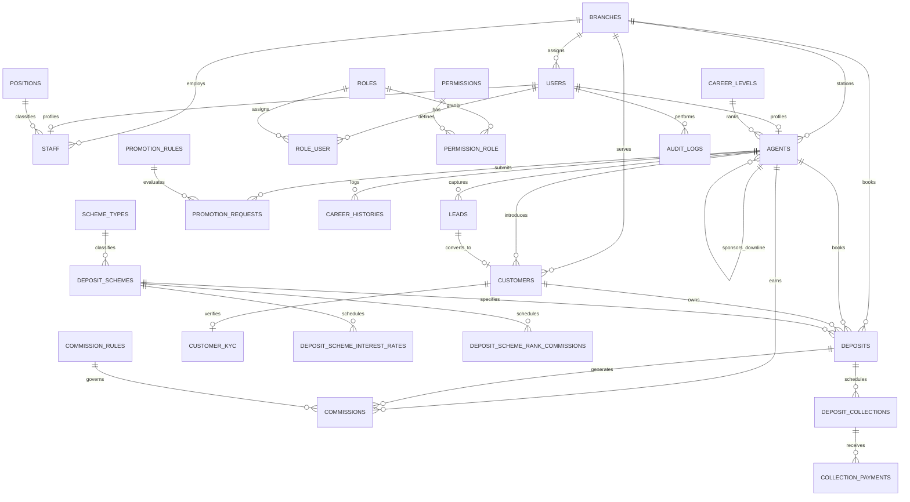

# Database Reference: MultiCred Schema & Data Dictionary

## 1. Database Architecture & Conventions

- **Database Engine**: MySQL `8.0+` or MariaDB `10.4+` (InnoDB storage engine with full foreign key support).
- **Default Database Name**: `multicred-deposit-commission`.
- **Character Set & Collation**: `utf8mb4_unicode_ci` (full multilingual support).
- **Primary Keys**: Auto-incrementing unsigned 64-bit integers (`bigint(20) unsigned id`).
- **Timestamps**: Standard Laravel `created_at` and `updated_at` nullable timestamps.
- **Soft Deletes**: Active on all financial and membership tables via `deleted_at nullable timestamp` (`Illuminate\Database\Eloquent\SoftDeletes`).
- **Financial Precision**: Monetary amounts and interest rates use explicit decimal types (e.g. `decimal(15,2)` for currency and `decimal(8,2)` / `decimal(5,2)` for interest and commission percentages). Never float or double.
- **Transactional Safety**: Financial mutations and status state machines are executed inside `DB::transaction()` with pessimistic row-level locking (`lockForUpdate()`).

---

## 2. Entity Relationship Overview Diagram

---

## 3. Data Dictionary: Core Tables & Schemas

### 3.1 Organization & Personnel

#### `branches`
Represents physical society branch offices.
| Column | Type | Nullable | Description / Constraints |
| :--- | :--- | :--- | :--- |
| `id` | `bigint unsigned` | NO | Auto-increment primary key |
| `name` | `varchar(255)` | NO | Physical branch name |
| `code` | `varchar(50)` | NO | Unique branch code (e.g. `BR001`), indexed |
| `email` | `varchar(255)` | YES | Branch notification email |
| `phone` | `varchar(50)` | YES | Contact phone number |
| `address` | `text` | YES | Postal street address |
| `status` | `varchar(20)` | NO | Default `'active'`, status (`active`/`inactive`) |
| `password` | `varchar(255)` | YES | Optional legacy branch password |
| `created_at` / `updated_at` | `timestamp` | YES | Standard timestamps |
| `deleted_at` | `timestamp` | YES | Soft delete timestamp |

#### `positions`
Staff organizational job titles and hierarchy order.
| Column | Type | Nullable | Description / Constraints |
| :--- | :--- | :--- | :--- |
| `id` | `bigint unsigned` | NO | Primary key |
| `title` | `varchar(255)` | NO | Position title (e.g. "Senior Cashier", "Branch Manager") |
| `code` | `varchar(50)` | YES | Unique position code |
| `sort_order` | `int unsigned` | NO | Display and hierarchy sort order |
| `status` | `varchar(20)` | NO | Status (`active`/`inactive`) |

#### `staff`
Operational employees assigned to branches.
| Column | Type | Nullable | Description / Constraints |
| :--- | :--- | :--- | :--- |
| `id` | `bigint unsigned` | NO | Primary key |
| `user_id` | `bigint unsigned` | YES | Foreign key &rarr; `users.id` (ON DELETE SET NULL) |
| `branch_id` | `bigint unsigned` | YES | Foreign key &rarr; `branches.id` |
| `position_id` | `bigint unsigned` | YES | Foreign key &rarr; `positions.id` |
| `staff_code` | `varchar(50)` | YES | Unique employee code (`STF001`) |
| `employee_id` | `varchar(50)` | YES | Organization employee ID |
| `name` | `varchar(255)` | NO | Staff member's full name |
| `email` | `varchar(255)` | YES | Contact email |
| `phone` | `varchar(50)` | YES | Mobile phone number |
| `permissions` | `json` | YES | Array of granted permission slugs (e.g. `["view-deposits"]`) |
| `status` | `varchar(20)` | NO | Account status (`active`/`inactive`) |

---

### 3.2 Agency Network & Career Levels

#### `career_levels` (also referenced as `ranks`)
Defines the 12 standardized career progression tiers.
| Column | Type | Nullable | Description / Constraints |
| :--- | :--- | :--- | :--- |
| `id` | `bigint unsigned` | NO | Primary key |
| `level` | `int unsigned` | NO | Career level number (1 through 12), unique |
| `name` | `varchar(100)` | NO | Rank title (e.g. `Facilitator`, `Deputy Director`) |
| `code` | `varchar(50)` | NO | Rank identifier (e.g. `FACILITATOR`, `DEPUTY_DIRECTOR`) |
| `description` | `text` | YES | Role responsibilities |
| `sort_order` | `int unsigned` | NO | Ordering for promotion logic |
| `status` | `varchar(20)` | NO | Default `'active'` |

#### `agents`
Registered field agents and advisors.
| Column | Type | Nullable | Description / Constraints |
| :--- | :--- | :--- | :--- |
| `id` | `bigint unsigned` | NO | Primary key |
| `agent_id` | `varchar(50)` | YES | Sequential unique ID (e.g. `AG000001`) |
| `member_code` | `varchar(50)` | YES | Society member code (e.g. `MBR10023`) |
| `user_id` | `bigint unsigned` | YES | Foreign key &rarr; `users.id` |
| `branch_id` | `bigint unsigned` | YES | Foreign key &rarr; `branches.id` (nullable for free-floating field agents) |
| `rank_id` | `bigint unsigned` | YES | Foreign key &rarr; `career_levels.id` |
| `parent_agent_id` | `bigint unsigned` | YES | Foreign key &rarr; `agents.id` (upline sponsor) |
| `name` | `varchar(255)` | NO | Agent full name |
| `email` | `varchar(255)` | YES | Contact email |
| `phone` | `varchar(50)` | YES | Mobile phone number |
| `profile_image` | `varchar(255)` | YES | Path to avatar image in public storage |
| `joining_date` | `date` | YES | Date registered in society |
| `place` | `varchar(255)` | YES | Geographic operational base |
| `status` | `varchar(20)` | NO | Status (`active`/`inactive`/`pending`) |
| `deleted_at` | `timestamp` | YES | Soft delete timestamp |

---

### 3.3 Leads, Customers & KYC

#### `leads`
Prospective member inquiries logged by field agents.
| Column | Type | Nullable | Description / Constraints |
| :--- | :--- | :--- | :--- |
| `id` | `bigint unsigned` | NO | Primary key |
| `agent_id` | `bigint unsigned` | NO | Foreign key &rarr; `agents.id` |
| `branch_id` | `bigint unsigned` | YES | Foreign key &rarr; `branches.id` |
| `interested_scheme_id` | `bigint unsigned` | YES | Foreign key &rarr; `deposit_schemes.id` |
| `name` | `varchar(255)` | NO | Prospect's full name |
| `mobile` | `varchar(20)` | YES | Contact phone number |
| `email` | `varchar(255)` | YES | Contact email |
| `address` | `text` | YES | Street location |
| `expected_amount` | `decimal(15,2)` | YES | Target contribution amount |
| `follow_up_date` | `date` | YES | Scheduled follow-up reminder |
| `status` | `varchar(50)` | NO | `NEW`, `CONTACTED`, `INTERESTED`, `CONVERTED`, `NOT_INTERESTED` |
| `converted_customer_id` | `bigint unsigned` | YES | Foreign key &rarr; `customers.id` upon conversion |
| `converted_at` | `timestamp` | YES | Conversion timestamp |

#### `customers`
Managed society members holding deposit accounts.
| Column | Type | Nullable | Description / Constraints |
| :--- | :--- | :--- | :--- |
| `id` | `bigint unsigned` | NO | Primary key |
| `customer_number` | `varchar(50)` | NO | Unique customer code (e.g. `CUST000001`) |
| `name` | `varchar(255)` | NO | Customer full name |
| `customer_type` | `varchar(50)` | NO | Default `'INDIVIDUAL'` |
| `mobile` | `varchar(20)` | YES | Contact phone number |
| `email` | `varchar(255)` | YES | Contact email |
| `date_of_birth` | `date` | YES | Birth date (used for senior citizen eligibility) |
| `address` | `text` | YES | Address details |
| `pin_code` | `varchar(20)` | YES | Postal code |
| `branch_id` | `bigint unsigned` | YES | Foreign key &rarr; `branches.id` |
| `agent_id` | `bigint unsigned` | YES | Foreign key &rarr; `agents.id` (introducing agent) |
| `status` | `varchar(20)` | NO | `ACTIVE`, `INACTIVE` |
| `deleted_at` | `timestamp` | YES | Soft delete timestamp |

---

### 3.4 Deposit Schemes, Rates & Commissions

#### `deposit_schemes`
Product blueprints for savings schemes.
| Column | Type | Nullable | Description / Constraints |
| :--- | :--- | :--- | :--- |
| `id` | `bigint unsigned` | NO | Primary key |
| `scheme_code` | `varchar(50)` | NO | Unique scheme identifier code |
| `name` | `varchar(255)` | NO | Display name of scheme |
| `scheme_type` | `varchar(50)` | NO | Product class (`FD`, `RD`, `DD`, `MIS`) |
| `interest_rate` | `decimal(8,2)` | NO | Base annual interest percentage |
| `senior_citizen_extra_rate` | `decimal(5,2)` | NO | Default `0.50`, bonus interest rate |
| `tenure` | `int unsigned` | NO | Base duration value |
| `tenure_unit` | `varchar(20)` | NO | `DAYS`, `MONTHS`, `YEARS` |
| `collection_frequency` | `varchar(50)` | NO | `ONE_TIME`, `DAILY`, `WEEKLY`, `MONTHLY` |
| `total_commission_percentage` | `decimal(5,2)` | NO | Cumulative max commission percentage |
| `status` | `varchar(20)` | NO | Status (`active`/`inactive`) |

#### `deposit_scheme_interest_rates`
Multi-year tenure interest rate schedule matrix.
| Column | Type | Nullable | Description / Constraints |
| :--- | :--- | :--- | :--- |
| `id` | `bigint unsigned` | NO | Primary key |
| `deposit_scheme_id` | `bigint unsigned` | NO | Foreign key &rarr; `deposit_schemes.id` |
| `tenure` | `int unsigned` | NO | Tenure duration (e.g. 1, 2, 3) |
| `tenure_unit` | `varchar(20)` | NO | `MONTHS`, `YEARS` |
| `interest_rate` | `decimal(8,2)` | NO | Annual interest rate percentage for this tenure |
| `senior_citizen_extra_rate`| `decimal(5,2)` | NO | Senior citizen bonus rate for this tenure |
| `effective_from` | `date` | YES | Rate start validity date |
| `effective_to` | `date` | YES | Rate expiry validity date |
| `status` | `varchar(20)` | NO | Status (`active`/`inactive`) |

#### `deposit_scheme_rank_commissions`
Rank-specific commission payout percentages per tenure year.
| Column | Type | Nullable | Description / Constraints |
| :--- | :--- | :--- | :--- |
| `id` | `bigint unsigned` | NO | Primary key |
| `deposit_scheme_id` | `bigint unsigned` | NO | Foreign key &rarr; `deposit_schemes.id` |
| `rank_id` | `bigint unsigned` | NO | Foreign key &rarr; `career_levels.id` |
| `payout_year` | `int unsigned` | NO | Payout amortization year (Year 1 through 7) |
| `commission_percentage` | `decimal(5,2)` | NO | Commission percentage allocated to this rank and year |
| `is_eligible` | `boolean` | NO | Default `true`, eligibility toggle |

---

### 3.5 Deposit Accounts, Collections & Ledger

#### `deposits`
Active, matured, and closed customer deposit accounts.
| Column | Type | Nullable | Description / Constraints |
| :--- | :--- | :--- | :--- |
| `id` | `bigint unsigned` | NO | Primary key |
| `deposit_number` | `varchar(50)` | NO | Unique account number (`DEP000001`), indexed |
| `customer_id` | `bigint unsigned` | YES | Foreign key &rarr; `customers.id` |
| `lead_id` | `bigint unsigned` | YES | Foreign key &rarr; `leads.id` (originating lead) |
| `branch_id` | `bigint unsigned` | NO | Foreign key &rarr; `branches.id` |
| `agent_id` | `bigint unsigned` | NO | Foreign key &rarr; `agents.id` (booking agent) |
| `deposit_scheme_id` | `bigint unsigned` | YES | Foreign key &rarr; `deposit_schemes.id` |
| `amount` | `decimal(15,2)` | NO | Principal investment amount |
| `start_date` | `date` | NO | Deposit opening date |
| `tenure` | `int unsigned` | NO | Tenure duration value |
| `tenure_unit` | `varchar(20)` | NO | `MONTHS`, `YEARS` |
| `interest_rate` | `decimal(8,2)` | NO | Applied interest percentage |
| `maturity_date` | `date` | NO | Scheduled completion maturity date |
| `maturity_amount` | `decimal(15,2)` | NO | Total payout amount due at maturity |
| `payment_mode` | `varchar(50)` | NO | `CASH`, `BANK_TRANSFER`, `CHEQUE`, `ONLINE_UPI`, `DEMAND_DRAFT` |
| `payment_reference` | `varchar(100)` | YES | Bank reference, UTR, or cheque number |
| `nominee_name` | `varchar(255)` | YES | Nominee legal name |
| `nominee_relation` | `varchar(50)` | YES | Relationship to account holder |
| `status` | `varchar(20)` | NO | `DRAFT`, `PENDING_APPROVAL`, `APPROVED`, `ACTIVE`, `MATURED`, `CLOSED`, `REJECTED` |
| `approved_by` / `at` | `bigint unsigned` / `datetime` | YES | Approval officer and timestamp |
| `verified_by` / `at` | `bigint unsigned` / `datetime` | YES | Verification officer and timestamp |
| `deleted_at` | `timestamp` | YES | Soft delete timestamp |

#### `commission_ledgers` (referenced via `Commission` Model)
Financial ledger recording every commission voucher.
| Column | Type | Nullable | Description / Constraints |
| :--- | :--- | :--- | :--- |
| `id` | `bigint unsigned` | NO | Primary key |
| `commission_number` | `varchar(50)` | NO | Unique voucher ID (`COM000001`) |
| `agent_id` | `bigint unsigned` | NO | Foreign key &rarr; `agents.id` |
| `branch_id` | `bigint unsigned` | NO | Foreign key &rarr; `branches.id` |
| `deposit_id` | `bigint unsigned` | YES | Foreign key &rarr; `deposits.id` |
| `deposit_collection_id`| `bigint unsigned`| YES | Foreign key &rarr; `deposit_collections.id` |
| `rule_id` | `bigint unsigned` | YES | Foreign key &rarr; `commission_rules.id` |
| `payout_year` | `int unsigned` | NO | Payout amortization year (Year 1 to 7) |
| `base_amount` | `decimal(15,2)` | NO | Amount commission was computed on |
| `rate` | `decimal(5,2)` | NO | Applied commission percentage |
| `commission_amount` | `decimal(15,2)` | NO | Net commission payable (₹) |
| `status` | `varchar(20)` | NO | `PENDING`, `APPROVED`, `PAYABLE`, `PAID`, `REJECTED` |
| `payment_method` | `varchar(50)` | YES | Payment mode on disbursement |
| `reference_number` | `varchar(100)` | YES | Payment disbursement reference |
| `paid_at` | `datetime` | YES | Payout timestamp |
| `paid_by` | `bigint unsigned` | YES | Foreign key &rarr; `users.id` (paying officer) |
| `deleted_at` | `timestamp` | YES | Soft delete timestamp |

---

### 3.6 Career Progression & Audit Logs

#### `promotion_rules`
Qualification criteria configured per career rank transition.
| Column | Type | Nullable | Description / Constraints |
| :--- | :--- | :--- | :--- |
| `id` | `bigint unsigned` | NO | Primary key |
| `from_rank_id` | `bigint unsigned` | NO | Current rank (`career_levels.id`) |
| `to_rank_id` | `bigint unsigned` | NO | Target advancement rank (`career_levels.id`) |
| `min_active_customers` | `int unsigned` | YES | Required personal customer count |
| `min_deposit_amount` | `decimal(15,2)` | YES | Required personal deposit volume (₹) |
| `min_collection_amount`| `decimal(15,2)` | YES | Required installment collection turnover (₹) |
| `min_tenure_days` | `int unsigned` | YES | Minimum service duration in days |
| `min_qualifying_agents`| `int unsigned` | YES | Required qualified downline agents count |
| `qualifying_agent_tiers`| `json` | YES | JSON array of required downline rank IDs |
| `status` | `varchar(20)` | NO | Default `'active'` |

#### `audit_logs`
Immutable compliance and financial event trail.
| Column | Type | Nullable | Description / Constraints |
| :--- | :--- | :--- | :--- |
| `id` | `bigint unsigned` | NO | Primary key |
| `user_id` | `bigint unsigned` | YES | Acting user (`users.id`) |
| `branch_id` | `bigint unsigned` | YES | Branch context (`branches.id`) |
| `event` | `varchar(100)` | NO | Event identifier (e.g. `deposit_approved`, `commission_paid`) |
| `auditable_type` | `varchar(255)` | YES | Eloquent polymorphic class name |
| `auditable_id` | `bigint unsigned` | YES | Polymorphic record primary key |
| `old_values` | `json` | YES | Attribute snapshot before mutation |
| `new_values` | `json` | YES | Attribute snapshot after mutation |
| `amount` | `decimal(15,2)` | YES | Associated monetary transaction amount |
| `ip_address` | `varchar(45)` | YES | Client IP address |
| `description` | `text` | YES | Human-readable audit narrative |
| `created_at` | `timestamp` | YES | Event timestamp |

---

## 4. Key Data Invariants & Integrity Constraints

1. **Cumulative Commission Cap**: The sum of rank commission percentages for any scheme year cannot exceed 100.00% (`FdCommissionSchemeService::calculateTotalCommission`).
2. **Sequential Entity Numbering**: Numbering prefixes are strictly enforced via atomic DB locking (`AG`, `CUST`, `DEP`, `COL`, `COM`, `PR`, `PAY`).
3. **Pessimistic Duplicate Prevention**: `lockForUpdate()` is mandated inside `DB::transaction()` prior to writing to `commissions` and `deposits`.
4. **Soft Delete Preservation**: Primary transactional records must never be hard deleted from production.
